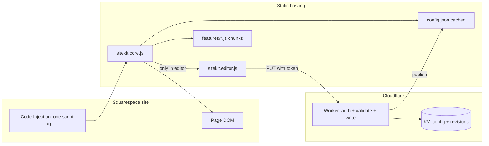
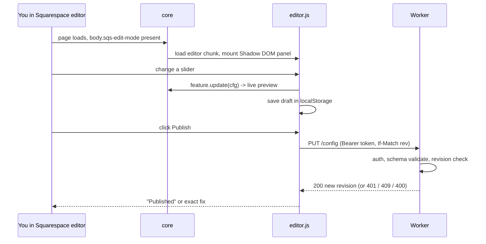

# 03 - Architecture

Companion docs: `01-research-findings.md` (why), `02-product-brief-prd.md` (what), `04-test-plan.md` (proof).

## 1. Architecture in one page



Three rules drive everything:

1. **Visitors get the runtime only.** The editor is a separate file loaded only inside the Squarespace editor.
2. **Config is static and cached.** Visitors never hit the Worker; only the editor writes through it.
3. **Squarespace is hostile territory.** Every assumption about its DOM is isolated, probed, tested nightly and has a kill switch.

## 2. Components

### 2.1 Loader tag (in Squarespace Code Injection)

```html
<script src="https://cdn.jsdelivr.net/gh/USER/REPO@1.0.0/dist/sitekit.core.js"
        integrity="sha384-..." crossorigin="anonymous"
        data-config="https://config.YOURDOMAIN.workers.dev/config.json" defer></script>
```

- Exact version pinned. SRI hash generated by CI and pasted by you on each release.
- Updating the site = editing this one tag. Rolling back = editing it back.

### 2.2 Core runtime (`sitekit.core.js`, <= 8 KB gz)

| Module | Responsibility |
|--------|----------------|
| `boot` | Entry. Reads `data-config`, checks kill switch, starts everything, never throws. |
| `kill-switch` | `?sitekit=off`, config `disabled`, detects Squarespace safe mode (if scripts disabled we never run). |
| `config-client` | Cache-first: apply last config from `localStorage` instantly, revalidate over network, apply diff if changed. Schema-validates before use. |
| `registry` | Holds feature definitions; lazy-loads the chunk for a feature only if enabled. |
| `lifecycle` | Calls `init/update/destroy`; wraps each in try/catch; collects errors. |
| `spa` | Re-runs on `mercury:load` and on DOM readiness; debounced `MutationObserver` only for features that ask for it. |
| `adapters/squarespace` | **The only file that knows Squarespace internals** (see 2.5). |
| `edit-detect` | Detects editor (`body.sqs-edit-mode`) and loads `sitekit.editor.js` when true. |
| `css` | Writes one `<style data-sitekit>` with CSS variables and scoped rules from validated config only. |
| `log` | Prefixed console logging; optional sampled beacon. |

### 2.3 Feature modules (`features/<id>/`)

Contract (TypeScript):

```ts
interface Feature<C> {
  id: string;                       // 'backToTop'
  label: string;                    // shown in panel
  version: number;                  // bump when schema changes
  schema: Field[];                  // drives panel + validation
  defaults: C;
  migrate?(old: unknown, from: number): C;   // schema evolution
  probe?(env: SqspEnv): ProbeResult;         // can this feature work on this page?
  init(cfg: C, env: SqspEnv): void;          // must be idempotent
  update(cfg: C, env: SqspEnv): void;        // live preview calls this
  destroy(): void;                           // must fully clean up
}
```

Rules:
- A feature owns a unique marker (`data-sk="backToTop"`) on everything it adds, so cleanup is `querySelectorAll('[data-sk=...]')`.
- Prefer **adding your own elements** over restyling Squarespace's internals (smaller blast radius).
- When styling existing blocks: use CSS variables + attribute selectors scoped by your own class, never edit Squarespace's own rules.
- Animation libraries are loaded lazily inside the feature chunk, only if the feature is enabled.

### 2.4 Editor (`sitekit.editor.js`, loaded only in the editor)

- **Preact** component tree inside a **Shadow DOM** host. Framework size is irrelevant to visitors because they never load this file.
- Views: Feature list (search) -> Feature settings -> (later) Target picker.
- A control component per field type, generated from the feature `schema`.
- State: single store `{ draft, published, revision, dirty }`. Every change calls `feature.update()` for live preview and writes the draft to `localStorage`.
- Publish: `PUT` to the Worker with `If-Match: <revision>`.
- Must not break Squarespace's editor: no global key/mouse handlers except Esc while open, `pointer-events` only on the panel, `z-index` below Squarespace modals if they exist (verify), never move/modify Squarespace editor DOM.
- Mount point: floating button inside the page (works whether the preview is an iframe or same document). Injecting into Squarespace's own toolbar is **out of scope** (fragile, unsupported).

### 2.5 Squarespace adapter (the resilience layer)

All Squarespace-specific knowledge lives in `src/adapters/squarespace.ts`:

```ts
export const SELECTORS = {
  // Official Custom Code Specification (stable)
  section: '[data-sqsp-section]',
  block: (type: string) => `[data-sqsp-block="${type}"]`,
  textContent: '[data-sqsp-text-block-content]',
  // Community-documented (NOT guaranteed) - each has a fallback + a test
  editMode: 'body.sqs-edit-mode',
  editActive: 'body.sqs-edit-mode-active',
  sectionIdAttr: 'data-section-id',
} as const;
```

Policy:
1. Use spec attributes first.
2. Any non-spec selector must be listed here with `// UNSTABLE`, have a fallback and a test.
3. Features import from the adapter and never write raw Squarespace selectors.
4. `probe()` results feed the editor ("This feature can't find what it needs on this page").

### 2.6 Target resolver (for features that style specific blocks, from Release 2)

Because section and block ids are not in the official spec, a "target" is stored as several signals, not one:

```json
{
  "targetId": "t_9fk2",
  "anchor": "my-hero",                        // human-made section anchor id (persistent per spec)
  "blockId": "block-yui_3_17_2_1_1700000000", // community-known, may change on duplicate
  "sectionIndex": 2,
  "blockType": "text",
  "blockOrdinal": 1,                          // nth block of that type in the section
  "textHash": "a81c..."                       // fingerprint of visible text (optional)
}
```

Resolution order: anchor -> blockId -> (section index + type + ordinal) -> text hash. If none resolves, the target is flagged **orphaned** in the panel with a "re-pick" button. Never guess silently.

### 2.7 Config backend

**Read path (visitors):** `config.json` served as a static, cacheable file. Two good options (choose in ADR-2):
- A. Worker serves it from KV **with the Cache API in front** (visitors hit the edge cache, not KV; KV reads stay near zero).
- B. CI publishes `config.json` to the repo / Cloudflare Pages / R2 public bucket on each Publish.

**Write path (editor only):** `PUT /config` -> Worker validates token, validates JSON against schema, checks `If-Match` revision, writes KV (`config` and `rev:<n>`), purges cache. Free KV allows **1,000 writes/day and 1 write/sec per key**, which is plenty for a human clicking Publish.

Config schema (v1):

```json
{
  "schemaVersion": 1,
  "revision": 42,
  "updatedAt": "2026-10-23T10:00:00Z",
  "disabled": false,
  "features": {
    "backToTop": { "v": 1, "enabled": true, "side": "right", "offsetX": 24, "offsetY": 24,
                   "size": 48, "radius": 50, "bg": "#0f766e", "fg": "#ffffff",
                   "showAfter": 400, "smooth": true }
  },
  "targets": {}
}
```

Validation: every field has a type and range in its schema; colors must match `^#[0-9a-fA-F]{6}$`; strings length-capped; unknown keys dropped. **Never** inject config strings as HTML or into CSS without whitelisting.

### 2.8 Build, release, delivery

- TypeScript + esbuild. Outputs: `dist/sitekit.core.js`, `dist/sitekit.editor.js`, `dist/features/*.js`, `dist/manifest.json` (file sizes, SRI hashes).
- GitHub Actions: lint -> typecheck -> unit -> build -> size-limit -> e2e (fixtures) -> on tag: create release, compute SRI, attach manifest.
- Delivery through jsDelivr from the GitHub tag. Always pin the version; never use `@latest`.
- Nightly workflow: Playwright smoke tests against the canary Squarespace site (see test plan), opens a GitHub issue on failure.

## 3. Key flows

### 3.1 Visitor page load

```mermaid
sequenceDiagram
  participant B as Browser
  participant S as Squarespace page
  participant C as CDN
  B->>S: load page
  S->>C: defer script sitekit.core.js (SRI)
  C-->>B: core (<=8KB)
  B->>B: kill switch? no. Apply cached config from localStorage
  B->>C: GET config.json (cache, revalidate)
  C-->>B: config (or 304)
  B->>B: validate; lazy-load chunks for enabled features; init each (try/catch)
  Note over B: Editor file is NOT downloaded
```

### 3.2 Editing and publishing



### 3.3 When Squarespace changes something

1. Nightly canary fails -> GitHub issue with screenshot + failing `probe()`.
2. You fix the one selector in `adapters/squarespace.ts`, add a regression fixture, release `1.0.x`.
3. Update the version in the Code Injection tag. If urgent: set `disabled: true` in config to switch everything off in about a minute.

## 4. Security model

| Threat | Control |
|--------|---------|
| Anyone could edit your site's behaviour | Writes require a bearer token (stored only in your editor browser's localStorage, prompted once). Public snippet has no secrets. |
| Malicious config -> XSS / CSS injection | Schema validation on Worker and client; whitelist-only values; no `innerHTML` with config data; no `eval`. |
| CDN or repo compromise | Pin exact version + SRI hash; 2FA on GitHub/Cloudflare; minimal deps; lockfile; CI `npm audit`; protected main branch. |
| Token theft via XSS on your site | Token lives only in the editor context; panel in Shadow DOM; short token rotation; Cloudflare rate limiting on the Worker. |
| CORS abuse | `GET` public; `PUT` requires token; reject unexpected `Origin` on writes (allow-list your site and Squarespace editor origins). |
| Visitor privacy | No cookies, no analytics, no PII. |

Upgrade path for auth (R3+): Cloudflare Access or passkeys instead of a static token.

## 5. Performance model

- Core is tiny and `defer`red; no render-blocking.
- Last-known config is applied synchronously from `localStorage`, so there is no "flash of default" on repeat visits.
- Features create elements with `position: fixed` or reserved dimensions to avoid layout shift.
- Animation libs (GSAP, Lenis) are loaded only by features that need them.
- Budgets enforced by `size-limit` in CI; build fails on regression.

## 6. Architecture Decision Records (ADRs)

| ADR | Decision | Why | Alternatives rejected |
|-----|----------|-----|-----------------------|
| 1 | Deliver via Squarespace Code Injection | Only supported path on 7.1 | Developer Platform (7.0 only); OAuth extension (wrong purpose) |
| 2 | Config = cached static JSON; Worker only for writes (Option A or B) | Keeps visitors off free-tier limits; fast; resilient | Worker+KV read per view (burns 100k/day, slower) |
| 3 | TypeScript + esbuild | Typed contracts for features, fast builds, tiny output | Plain JS (no safety net), webpack (heavier) |
| 4 | Editor in Shadow DOM | Squarespace CSS cannot break it | Iframe (focus/z-index issues), plain DOM (CSS clashes) |
| 5 | Editor is a separate lazy file | Visitors never pay for it | Single bundle (what the MVP file does today; refactor in M0) |
| 6 | Preact for the editor | Component model for growing UI; invisible to visitors | Vanilla (gets messy by feature 5); React (larger) |
| 7 | Multi-signal target resolver | Block ids not in the spec | Block id only (breaks silently) |
| 8 | Spec-first selectors behind one adapter | Matches Squarespace's own stability guidance | Selectors scattered in features |
| 9 | Pin + SRI + tag releases | Supply-chain safety, instant rollback | `@latest` |
| 10 | Canary Squarespace site + nightly Playwright | Only real way to detect Squarespace changes | Hoping |

## 7. Repository layout

```
sitekit/
  AGENTS.md
  docs/                       # these documents + verified-facts.md
  src/
    core/                     # boot, config-client, registry, lifecycle, spa, css, log
    adapters/squarespace.ts   # ALL Squarespace knowledge
    editor/                   # Preact panel (separate entry)
    features/
      backToTop/ {index.ts, schema.ts, styles.ts, backToTop.test.ts}
    shared/ {schema-validate.ts, types.ts}
  worker/ {src/index.ts, wrangler.toml, worker.test.ts}
  tests/
    fixtures/                 # HTML snapshots built from Custom Code Spec markup
    e2e/ {fixtures.spec.ts, canary.spec.ts}
  scripts/ {build.mjs, sri.mjs, size-report.mjs}
  .github/workflows/ {ci.yml, release.yml, canary.yml}
```

## 8. Mapping from the starter files you already have

| Today (`sitekit.js`) | Target |
|---|---|
| One IIFE with panel + feature + storage | Split into core / editor / feature (M0) |
| `FEATURES` object | `features/<id>/` modules implementing `Feature<C>` |
| `localStorage` draft + Worker PUT | Same idea; add schema validation, revision check, cache-first config |
| `isEditor()` | `adapters/squarespace.ts` `detectEditor()` |
| `worker.js` returning KV on every GET | Worker with schema validation + cache; read path cached/static |
